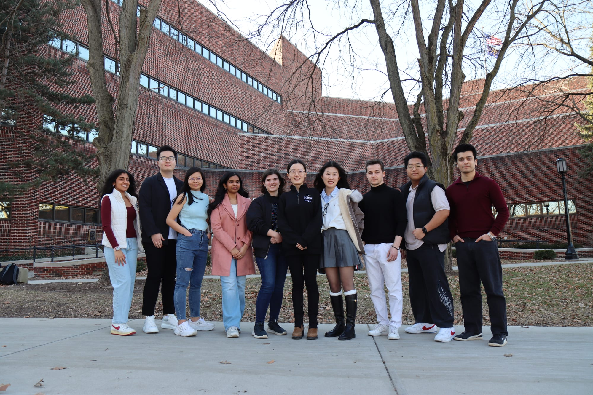
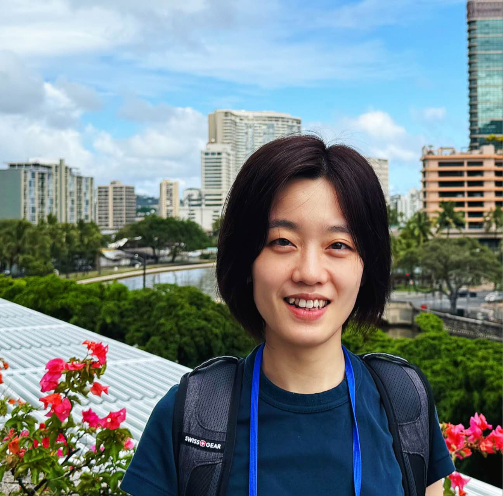
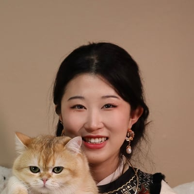
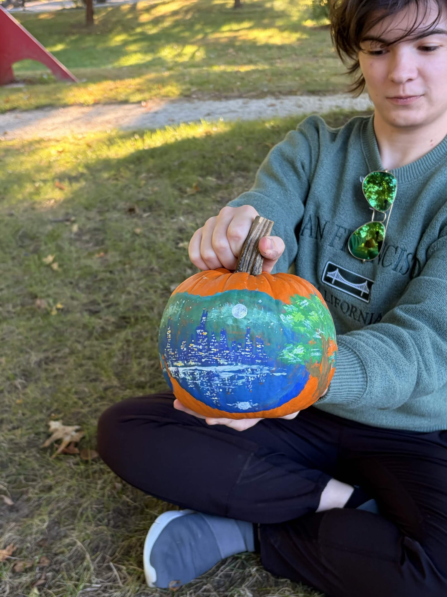
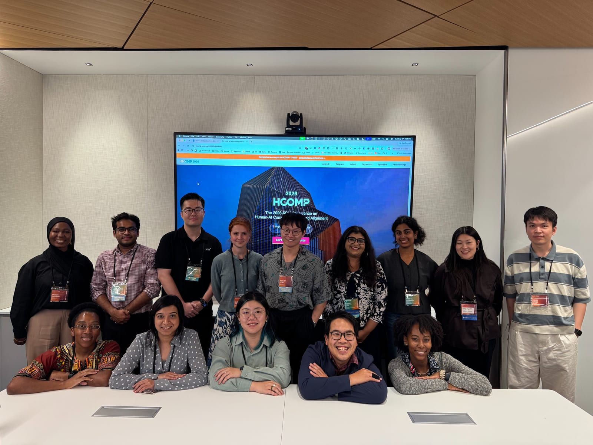
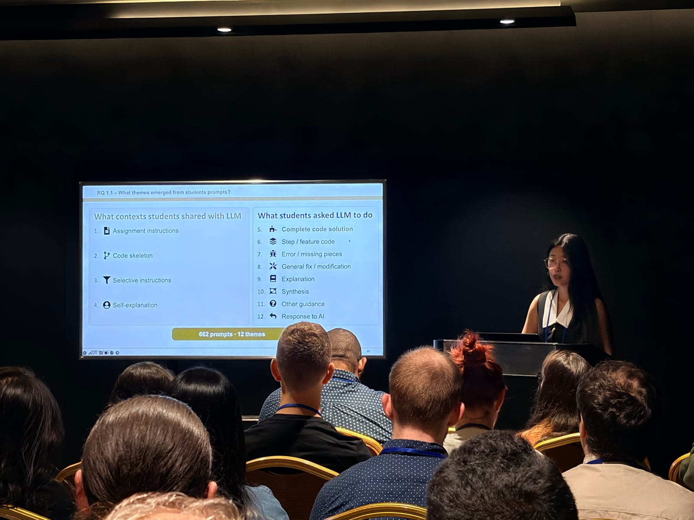
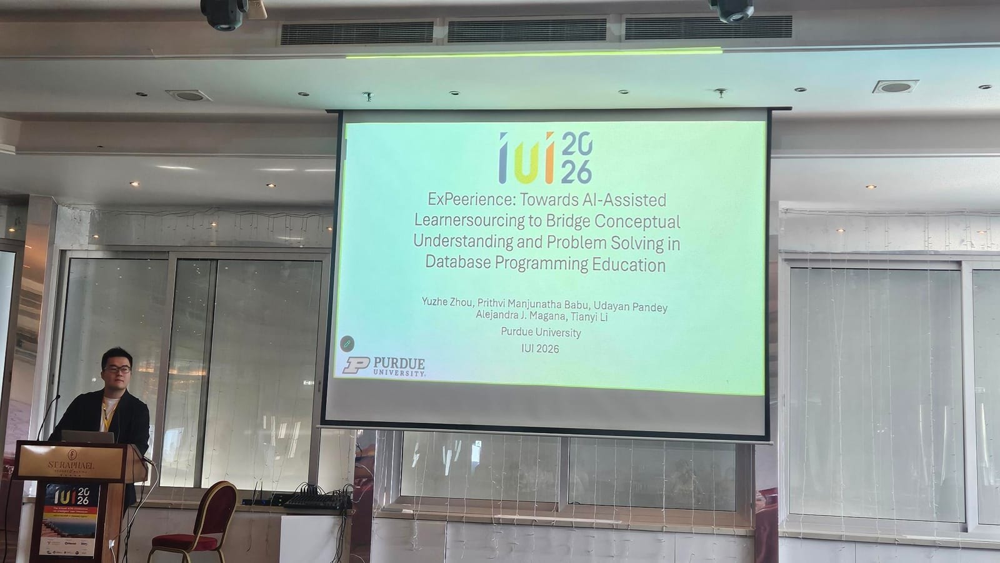
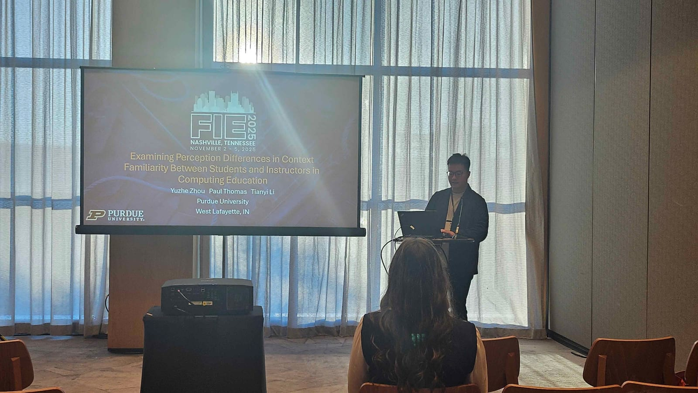

<!-- Generated by bin/build_content.rb from website-content. Edit the content files instead. -->

<figure class="group-photo"></figure>

The **Co-Intelligence Lab** at Purdue University studies how people learn, make sense of information, and create technology in collaboration with AI. We design interactive systems and study how people use them in classrooms, workplaces, and communities, with the goal of helping people use AI effectively and responsibly while keeping agency over their own goals and decisions.

## Members

### Director

Tianyi Li

### Ph.D. Students

Yuzhe Zhou

Jia Lin Cheohco-advised with Julia Rayz

<a href="https://scholar.google.com/citations?user=u1SFn_UAAAAJ">Tianyu Shao</a>

<a href="https://scholar.google.com/citations?user=dEQU_aIAAAAJ">Mingyang Wu</a>

Meng-Yu Wun

MGMarkeya Guco-advised with Alejandra J. Magana

### Doctor of Technology Students

SOSe Young Oh

JMJerry Hughes Martin

JSJoshua R. Spicer

### M.S. Students

DGDenison Guvenozco-advised with Julia Rayz

<a href="https://www.stanfeng7.website/">Tzu-En Feng</a>

<a href="https://hammadjavaid.com/">Hammad Javaid</a>

ABAbhinav Balakrishnan

MKManasvi Reddy Kothakotaco-advised with Tatiana Ringenberg

### Undergraduate Researchers

SYShyla Yadav

MHMark Tudor Haiduc

## Alumni

### Ph.D.

- **Hugo Armando Castellanos Morales**, Ph.D. 2026 (co-advised with Alejandra J. Magana)

### M.S.

- **Mohana Sravya Appalaneni**, M.S. 2026
- **Divya Sree Pulipati**, M.S. 2025
- **Yuzhe Zhou**, M.S. 2024

### Graduate Researchers

- Tanay Maheshwari
- Yiqun Zhang
- Miguel Alfonso Feijóo García
- Mohan Chi
- Huayu Tang
- Tanmay Surve
- Prithvi Manjunatha
- Zishuo Feng

### Undergraduate Researchers

- Alex Michael Voelker
- Satya Bonepalli
- Udayan Pandey
- Luke Matheny
- Eric Thompson
- Shreya Venkat
- Harmya Bhatt
- Paul Gherghetta

## Lab Life

<figure class="life-card">

<figcaption markdown="1">
Oct 2026 Denison Guvenoz with the pumpkin she painted, a moonlit city skyline, at the department's fall pumpkin painting.
</figcaption>
</figure>
<figure class="life-card">

<figcaption markdown="1">
Sep 2026 Yuzhe Zhou with fellow participants and organizers of the **HCOMP 2026** Doctoral Consortium in Arlington, VA.

[HCOMP 2026](https://hcomp.acm.org/2026/)
</figcaption>
</figure>
<figure class="life-card">

<figcaption markdown="1">
Jun 2026 [Tianyu Shao](https://scholar.google.com/citations?user=u1SFn_UAAAAJ) presenting our short paper at **AIED 2026** in Seoul, Korea: [*Tracing Prompt-Level Interaction Trajectories to Understand Student Learning with LLMs in Programming Education*](https://doi.org/10.1007/978-3-032-29770-9_29) (Tianyu Shao, Miguel Feijóo García, Yi Zhang, Hugo Castellanos, Tawfiq Salem, Alejandra J. Magana, and Tianyi Li)
</figcaption>
</figure>
<figure class="life-card">

<figcaption markdown="1">
Mar 2026 Yuzhe Zhou presenting our full paper at **IUI 2026** in Limassol, Cyprus: [*ExPeerience: Towards AI-Assisted Learnersourcing to Bridge Conceptual Understanding and Problem Solving in Database Programming Education*](https://doi.org/10.1145/3742413.3789139) (Yuzhe Zhou, Prithvi Manjunatha, Udayan Pandey, Alejandra J. Magana, and Tianyi Li)
</figcaption>
</figure>
<figure class="life-card">

<figcaption markdown="1">
Nov 2025 Yuzhe Zhou presenting our paper at **IEEE FIE 2025** in Nashville, TN: [*Examining Perception Differences in Context Familiarity Between Students and Instructors in Computing Education: A Case Study on Introductory Database Concepts*](https://doi.org/10.1109/FIE63693.2025.11328279) (Yuzhe Zhou, Paul Thomas, and Tianyi Li)
</figcaption>
</figure>

